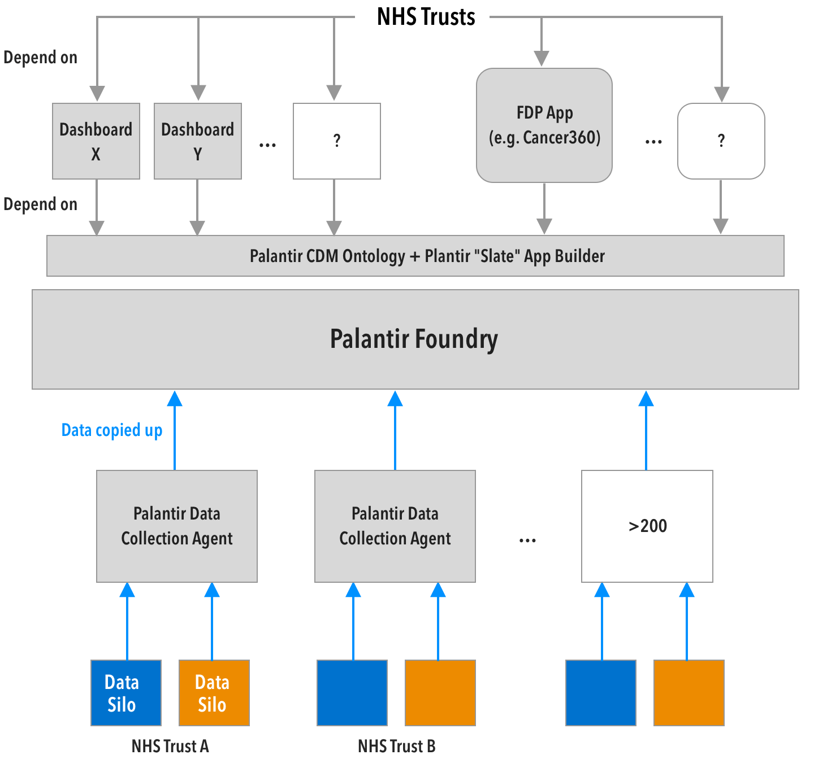

# Procuring legibility: Power, Palantir, and the NHS

> This transformative power resides not in the map, of course,   
> but rather in the power possessed by those who deploy  
> the perspective of that particular map.
>
> \- *James C. Scott, Seeing Like a State.*

This essay examines the contested decision by NHS England (NHSE) to award the £330m Federated Data Platform (FDP) contract to a Palantir-led consortium in 2023.

The NHS is a trademark owned by the Department of Health and Social Care (DHSC). Beneath that brand is a network of 202 semi-autonomous trusts, co-ordinated by 41 regional Integrated Care Boards across England. In 2025 it employed 1.37m people, slightly more than the 1.36m total population of Estonia. It is a complex system.   
(*NHS: Key Facts And Figures*, 2025)

Due to the diffusion of power and information across hundreds of sites and thousands of IT silos, it is also persistently “illegible” to the centre. From Scott’s “Seeing like a State” (2020), the decision is understood not only as a procurement of software, but an exercise in simplification driven by a desire for legibility and control from the centre.

Using Lukes’ (2021) “three views of power” I explore how the decision was shaped in advance by “agenda setting” and “shaping desires”.

Finally, building on Scott, I consider the negative consequences that fall on the centre rather than the citizens when it rents a platform for legibility, rather than building that capacity for itself.

## The Frustration: A deficit of “power over”

Building on Dahl, Lukes’ (2023) radical view lets us identify the power in its clearest form; overt “power over” (p. 27), where an explicit event shows one party exercising its power over another, visibly winning in some contested decision.

The official centre of the NHS (DHSC + NHSE) does not have direct power over the staff that deliver the service. As a quick orientation: The government, via the DHSC, has the power to decide the budget and the direction of NHS England. It publishes the “NHS Mandate” that sets the goals, and in 2025 granted it £204bn to pay the bills and deliver those goals. (Holmes, 2022)

In turn NHS England’s main function is to distribute those funds to the 41 Integrated Care Boards (ICB) that join up diverse healthcare services across a local area. It must report to the DHSC regularly on progress on delivering the mandate, but can only influence their delivery by negotiating with ICBs, or through shaping the system by setting procurement policy or directly providing national capabilities, including IT systems. (ibid)  

<small>
**Figure 1**: The flow of funding & reporting through the NHS. Source: Author's own work.
</small>

NHS trusts typically run hospitals, employ clinical staff and deliver care to patients. The targets in the NHS Mandate are met or missed here. Trusts are separate legal entities, manage their own budget, procure their own systems, and decide their own workflows.

Reporting on targets is manual and inconsistent between trusts. The centre can only see what the Trusts report. It has made promises to the public to reduce waiting times but it has no dashboard to help it understand where the bottlenecks are. (Betton, 2022)

The centre controls the total funding and targets. It lacks direct authority. It cannot order Trusts to share all their data or cut waiting times.

## The Desire: Efficiency and legibility

Scott (2023) provides a catalog of the harms caused by governments trying to simplify the messy reality that they must govern. Optimisations that make the domain more legible to the decision makers, have consequences as the participants are re-organised to better fit the system.

The FDP is a rebranding of Palantir’s Foundry platform. Foundry explicitly offers the NHS a digital legibility machine, “The Ontology System”, that facilitates the definition of a single model of how the centre would like to see and operate on all the information, and tools for trusts to copy and convert their diverse source data into that “Canonical Data Model”. (DHSC, 2023)

The “Briefing paper on the Federated Data Platform” (DHSC, 2023) frames the FDP as the solution to the clinical efficiency problems and a tool to clear waiting list backlogs by operationalising the data trusts already have, clearly setting this as an apolitical endeavour; the technology is a neutral solution to a pressing problem.

But software is political when it encodes a standard for how hundreds of individual healthcare sites must now translate their data in order to get access to the tools, and when individual agency over reporting is replaced with a digital requirement for continuous real-time transparency.

The promise of better tooling, and improving care outcomes here also carries with it a move for greater “infrastructural power” (Mann, 1984). Every trust that gets onboarded automatically becomes legible to the centre. Where the centre lacked "despotic power” to coerce trusts to adopt specific workflows it will now control the shared apps that encode those workflows. Trusts are being coaxed to adopt apps to improve their operational efficiency but also implicitly trade in the power to define those workflows, which is unacknowledged in the DHSC briefing paper or the NHSE FDP documentation.

## The Decision: Three views of power

As well as “power over”, Lukes (2023) identifies 2 further dimensions: The power to “control the agenda” deciding what topics may or may not be contested, and who is invited to contest them; and, his specific contribution: the power in “shaping of wants” where contests are avoided before they occur by persuading, or manipulating, through control of information or the entrenched biases in systems. 

The decision to award the FDP contract to Palantir against considerable resistance provides examples of all three.

### One-Dimensional view: Power over

Clinicians, represented by the British Medical Association (BMA) were publicly against the FDP contract being signed, citing the risk to patient health if they share less information with their doctor because they do not trust Palantir with their data. Civil society was equally vocal. Foxglove published an open letter to the House of Commons asking them to pause the procurement (Crider, 2023).The Good Law Project (2023) launched a campaign to get the contract published in underacted form for scrutiny. But Palantir won an open tender and NHSE won the contest. It used its authority to sign the contract and visibly exercised power over the clinicians and civil society.

### Two-Dimensional view: Control the agenda

The more subtle power to control what is not discussed is evident in how the possibility of an “in-house” alternative was kept off the agenda. Palantir’s initial NHS engagement was procured without an open tender, for £1, using emergency powers during COVID-19. (Gould, Joshi and Tang, 2020, Fitzgerald, 2020)The understandable urgency at the time had them reach for commercial off-the-shelf software that could be deployed immediately, effectively excluding any “build” vs “buy” discussion from the agenda.

Crucially, NHSE extended these emergency powers into 2023 when they awarded Palantir a £25m extension contract, again without an open tender, citing the risk to patient safety. (Black, 2021)

This permanent emergency precluded other options from being explored and allowed time for Palantir to train up NHS staff on its tools, an investment in familiarity that tilted the playing field in its favour in the run up to the FDP contract being signed.

The impact of avoiding this debate surfaced in an open letter from the NHS Chief Data and Analytics Officers Network (CDAON) to Ming Tang, formally expressing concerns about the implementation of the FDP because “we already have similar tools in use that presently exceed the capability and application of what the FDP is currently trying to develop or roll out at a system level” (Farr, 2025). The power to set the agenda is visible, and in this case noticed and challenged.

### Three-Dimensional view: Shaping of wants

Lukes (2023) argues that the two-dimensional view identifies power in “observable (overt or covert) conflict”, but is limited to studying “concrete decisions”: a visible conflict of interests must resolve in favour of one of the parties in order to determine the existence and direction of power. Lukes introduces the three-dimensional view that allows us to name the power of A over B that avoids conflict by “influencing, shaping or determining his very wants”. 

At the same time as using the emergency power to control the agenda, NHSE was implementing the “Data Saves Lives” programme, a multi-faceted strategy that links data sharing with health. In that context a desire for legibility across the NHS is rebranded as the way to deliver effective care. The inception of the project stated an open-ended goal to “get the right technical infrastructure in place” because “Data-driven technologies have so much potential for our health and care system, but we can only unlock this potential if we have the right technical infrastructure in place” (DHSC, 2022). The FDP is not mentioned, but open medical data standards like FHIR are.

One year on and the language of that goal was replaced with a strong statement that “we remain enthusiastic about the potential of data to improve services and save lives… At the centre of this is the Federated Data Platform which is being procured by NHS England underpinned and guided by an agreed technical architecture.” (NHS England, 2023)

The message changed: the architecture of the FDP is “agreed”. Supporting the platform is to support “saving lives”. The NHSE exercised its power to shape the narrative, to position the FDP as the critical component to unlocking a healthier future. 

## Consequences

> “We ransomed our dignity to the clouds”
>
> \- *Tom Stoppard, Rosencrantz and Guildenstern are dead.*

Continued pressure from NHSE to adopt the FDP is working. From the latest figures, (NHS England, 2025b), 75% of Trusts are signed up. Mark Bailie, Chair of the NHSE Digital, Data and Technology Committee, asserted in the last NHS England Board Meeting (4 December 2025): “where the full \[FDP\] suite is enabled it is very effective”.

This success comes at a cost. If it succeeds in replacing trusts’ locally designed workflows, each built, operated and understood by the trust that built it, then the NHS ecosystem becomes operationally dependent on Palantir Foundry for its essential tasks (See figure 2, “mapping the dependency”). From Scott (2023) we can see another case of “metis” - practical knowledge derived from experience being replaced by "techne" - systems of hard rules, assumed to be universally applicable.

There should be no doubt that the NHS can benefit greatly from better understanding the mass of data it produces. The current system leaves operating theatres empty when a booking spreadsheet contains an error. Any effort that helps trusts catch those errors before they happen will produce efficiency improvements, improve health outcomes and, in some cases, save lives. So what is the problem?

NHSE has chosen to rent legibility from a proprietary platform. The value of the huge, distributed effort to set up data integration pipelines from each trust is being done using Palantir’s software. Each site must configure their local systems to talk to Palantir’s. They don’t own that work, and have not defined an open protocol for it. Any suggestion that they could move to another platform implies redoing the hardest part. It has taken 2 years of coaxing to get this far.

In practice they are handing Palantir a monopoly over their data. The consequences are yet to be seen, but the NHSE FAQ (NHS England, 2025) frames their fixed 7 year contract term with Palantir as a key protection from lock-in. It seems more likely that this is the earliest point at which they will experience rent-seeking and the usual shifts in power that occur when you lack a credible exit at the negotiating table.

## Mapping the Dependency

Figure 2 shows the dependencies that the FDP architecture creates. Grey boxes represent digital infrastructure that would have to be replaced or rebuilt in order to switch to an alternative provider. 

  
<small>
	**Figure 2**: The dependency architecture of the FDP. Author's own work derived from Palantir Foundry developer documentation.</small>

## Reflection: High Modernist Coders

Roll (2018) identifies the power to interpret the rules available to “steet-level bureaucrats" when implementing a policy that inevitably lacks the nuance required to apply it unambiguously to social situations.

There is an equivalent here when software engineers are asked to translate a policy as code. Working methodically through requirements always reveals edge-cases. Experienced engineers learn it is always more efficient for them to code a “reasonable” ad-hoc solution and see if anyone complains, than to surface every undiscussed conflict. This interpretive power is often claimed only to keep a project deadline from slipping, yet the result is still a long series of corrections to a diktat, decided from an individual's sense of the intention of the rules.

When our digital street-level bureaucrats are only trained in rational, system engineering principles; the "administrative ordering of nature and society” (Scott, 2020), and they necessarily interpret the rules as they encode them, it follows that we will often be left with the least humane interpretations of a policy intent.

User-centered design is encouraged! Encodings that value and centre “metis” are possible, but practitioners must push against the norms here. This, I think, is close to the root of why I am studying [this course](https://www.ucl.ac.uk/bartlett/public-purpose/study/mpa).

## Bibliography

Betton, V. (2022) *Towards a Digital Health Ecology: NHS Digital Adoption through the COVID-19 Looking Glass*. First edition. Boca Raton: CRC Press. Available at: [https://doi.org/10.1201/9781032198798](https://doi.org/10.1201/9781032198798).

Black, C. (2021) *Revealed: Data giant given ‘emergency’ Covid contract had been wooing…*, *TBIJ*. Available at: [https://www.thebureauinvestigates.com/stories/2021-02-24/revealed-data-giant-given-emergency-covid-contract-had-been-wooing-nhs-for-months](https://www.thebureauinvestigates.com/stories/2021-02-24/revealed-data-giant-given-emergency-covid-contract-had-been-wooing-nhs-for-months) (Accessed: 15 January 2026).

‘Briefing paper on the Federated Data Platform’ (2023). Department Of Health. Available at: [https://data.parliament.uk/DepositedPapers/Files/DEP2023-0696/23083011.docx](https://data.parliament.uk/DepositedPapers/Files/DEP2023-0696/23083011.docx) (Accessed: 6 January 2026).

Crider, C. (2023) ‘Foxglove Open Letter to Steve Brine MP’. Available at: [https://committees.parliament.uk/publications/40981/documents/199605/default/](https://committees.parliament.uk/publications/40981/documents/199605/default/) (Accessed: 15 January 2026).

DHSC (2022) *Data saves lives: reshaping health and social care with data*, *GOV.UK*. Available at: [https://www.gov.uk/government/publications/data-saves-lives-reshaping-health-and-social-care-with-data/data-saves-lives-reshaping-health-and-social-care-with-data](https://www.gov.uk/government/publications/data-saves-lives-reshaping-health-and-social-care-with-data/data-saves-lives-reshaping-health-and-social-care-with-data) (Accessed: 15 January 2026).

DHSC (2025) *Road to recovery: the government’s 2025 mandate to NHS England*, *GOV.UK*. Available at: [https://www.gov.uk/government/publications/road-to-recovery-the-governments-2025-mandate-to-nhs-england/road-to-recovery-the-governments-2025-mandate-to-nhs-england](https://www.gov.uk/government/publications/road-to-recovery-the-governments-2025-mandate-to-nhs-england/road-to-recovery-the-governments-2025-mandate-to-nhs-england) (Accessed: 12 January 2026).

Farr, M. (2025) ‘Chief Data and Analytical Officer Network position on the Federated Data Platform (FDP)’, *AphA - Association of Professional Healthcare Analysts*, 25 February. Available at: [https://www.aphanalysts.org/cdao-network-news/chief-data-and-analytical-officer-network-position-on-the-federated-data-platform-fdp/](https://www.aphanalysts.org/cdao-network-news/chief-data-and-analytical-officer-network-position-on-the-federated-data-platform-fdp/) (Accessed: 15 January 2026).

Fitzgerald, M. (2020) *Under pressure, UK government releases NHS COVID data deals with big tech*, *openDemocracy*. Available at: [https://www.opendemocracy.net/en/ournhs/under-pressure-uk-government-releases-nhs-covid-data-deals-big-tech/](https://www.opendemocracy.net/en/ournhs/under-pressure-uk-government-releases-nhs-covid-data-deals-big-tech/) (Accessed: 14 January 2026).

Good Law Project (2023) ‘Should NHS England hand your medical records to a spy-tech firm run by a billionaire Trump supporter?’, *Good Law Project*, 20 July. Available at: [https://goodlawproject.org/update/should-nhs-england-hand-your-medical-records-to-a-spy-tech-firm-run-by-a-billionaire-trump-supporter/](https://goodlawproject.org/update/should-nhs-england-hand-your-medical-records-to-a-spy-tech-firm-run-by-a-billionaire-trump-supporter/) (Accessed: 14 January 2026).

Gould, M., Joshi, I. and Tang, M. (2020) *The power of data in a pandemic – Technology in the NHS*, *GOV.UK*. Available at: [https://healthtech.blog.gov.uk/2020/03/28/the-power-of-data-in-a-pandemic/](https://healthtech.blog.gov.uk/2020/03/28/the-power-of-data-in-a-pandemic/) (Accessed: 14 January 2026).

Holmes, J. (2022) *Understanding Accountabilities And Structures In The National Health And Care System In England*, *The King’s Fund*. Available at: [https://www.kingsfund.org.uk/insight-and-analysis/long-reads/understanding-accountabilities-structures-health-care](https://www.kingsfund.org.uk/insight-and-analysis/long-reads/understanding-accountabilities-structures-health-care) (Accessed: 12 November 2025).

Lukes, S. (2021) *Power: a radical view*. Third edition. London: Red Globe press.

Mann, M. (1984) ‘The autonomous power of the state: its origins, mechanisms and results’, *European Journal of Sociology*, 25(2), pp. 185–213. Available at: [https://doi.org/10.1017/S0003975600004239](https://doi.org/10.1017/S0003975600004239).

NHS England (2021) ‘Working together at scale: guidance on provider collaboratives’. Available at: [https://www.england.nhs.uk/wp-content/uploads/2021/06/B0754-working-together-at-scale-guidance-on-provider-collaboratives.pdf](https://www.england.nhs.uk/wp-content/uploads/2021/06/B0754-working-together-at-scale-guidance-on-provider-collaboratives.pdf) (Accessed: 12 January 2026).

NHS England (2023) *Data Saves Lives Implementation Update*, *NHS Transformation Directorate*. Available at: [https://transform.england.nhs.uk/key-tools-and-info/data-saves-lives/data-saves-lives-implementation-update/](https://transform.england.nhs.uk/key-tools-and-info/data-saves-lives/data-saves-lives-implementation-update/) (Accessed: 14 January 2026).

NHS England (2024) *Federated Data Platform and Associated Services - Contracts Finder*. Available at: [https://www.contractsfinder.service.gov.uk/Notice/0f8a65b5-23a2-4294-abb1-a7fd8efb3ad0](https://www.contractsfinder.service.gov.uk/Notice/0f8a65b5-23a2-4294-abb1-a7fd8efb3ad0) (Accessed: 5 December 2025).

NHS England (2025a) *NHS England » FDP FAQs*. Available at: [https://www.england.nhs.uk/digitaltechnology/nhs-federated-data-platform/fdp-faqs/](https://www.england.nhs.uk/digitaltechnology/nhs-federated-data-platform/fdp-faqs/) (Accessed: 15 January 2026).

NHS England (2025b) *NHS England » NHS Federated Data Platform uptake and benefits*. Available at: [https://www.england.nhs.uk/digitaltechnology/nhs-federated-data-platform/impact/fdp-uptake-and-benefits/](https://www.england.nhs.uk/digitaltechnology/nhs-federated-data-platform/impact/fdp-uptake-and-benefits/) (Accessed: 15 January 2026).

*NHS England Board Meeting – 4 December 2025* (2025). Available at: [https://www.youtube.com/watch?v=dYicztZvdXk](https://www.youtube.com/watch?v=dYicztZvdXk) (Accessed: 15 January 2026).

*NHS: Key Facts And Figures* (2025) *The King’s Fund*. Available at: [https://www.kingsfund.org.uk/insight-and-analysis/data-and-charts/key-facts-figures-nhs](https://www.kingsfund.org.uk/insight-and-analysis/data-and-charts/key-facts-figures-nhs) (Accessed: 11 January 2026).

Roll, K. (2018) ‘Street Level Bureaucrats and Post-conflict Policy-making: Corruption, Correctives, and the Rise of Veterans’ Pensions in Timor-Leste’, *Civil Wars*, 20(2), pp. 262–285. Available at: [https://doi.org/10.1080/13698249.2018.1477270](https://doi.org/10.1080/13698249.2018.1477270).

Scott, J.C. (2020) *Seeing like a state: how certain schemes to improve the human condition have failed*. New Haven: Yale University Press (Veritas Paperbacks Ser).

*Who can use the NHS Identity?* (no date) *NHS England*. Available at: [https://www.england.nhs.uk/nhsidentity/identity-guidelines/who-can-use-the-nhs-identity/](https://www.england.nhs.uk/nhsidentity/identity-guidelines/who-can-use-the-nhs-identity/) (Accessed: 11 January 2026).
